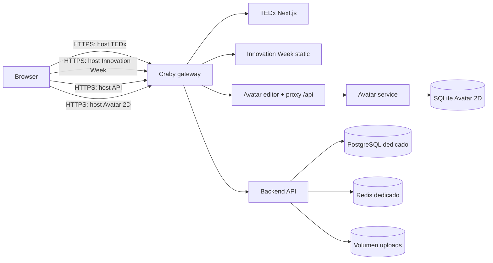

# Plan de despliegue aislado: TEDxUCB + Innovation Week

Estado: piloto aislado actualizado a `release-20261026-v2` el 2026-10-26. Las cinco imágenes se verificaron por SHA-256 antes de cargarlas; la base se respaldó y restauró en una instancia temporal aislada antes de aplicar las dos migraciones faltantes. Las 29 migraciones están al día y los servicios pasaron sus healthchecks internos. El inventario inicial está en [`inventario-servidor-2026-10-26.md`](inventario-servidor-2026-10-26.md). Los dominios están en Caddy pero todavía no resuelven por DNS; el acceso público/TLS y login desde esos orígenes siguen sin comprobarse. La entrega SMTP externa continúa aplazada como indicó el operador.

## 1. Objetivo y límites

Desplegar en el servidor existente, primero como piloto aislado, el backend compartido, TEDxUCB, Innovation Week y el flujo de Avatar 2D detrás del gateway HTTPS Craby. Todo debe funcionar como un stack independiente, con datos, contenedores, redes, volúmenes, variables y ciclo de vida propios. El piloto no equivale a habilitar un release público para usuarios generales.

**Límite invariable:** no editar, reiniciar, reconstruir, conectar ni reutilizar contenedores, bases, Redis, volúmenes, redes privadas, archivos de configuración o secretos del proyecto de Amazonia. El gateway es el único punto compartido y solo recibirá rutas aditivas para los nuevos hosts.

No usar Supabase productivo. La primera instalación tendrá una base PostgreSQL propia en el servidor o un servicio PostgreSQL dedicado y separado, según el inventario y la capacidad del host. No importar datos de Amazonia.

## 2. Topología objetivo

Los hosts exactos se definirán tras el inventario DNS/gateway de solo lectura. Preferir subdominios separados por aplicación y API; no cambiar el dominio/rutas existentes de Amazonia. El API no publicará puertos en el host: solo será accesible desde Craby y su red privada de aplicación. PostgreSQL, Redis y SQLite no tendrán exposición pública.

El editor 2D debe servirse con el proxy `/api` hacia su servicio Fastify, conservando un único origen para editor y miniaturas. Su servicio SQLite usará un volumen persistente exclusivo. La SPA de Innovation Week se sirve como estático con fallback de rutas; TEDx conserva su runtime Next.js. Cada frontend recibe el host HTTPS del API y del editor como configuración pública de build/runtime según su framework.

## 3. Inventario previo del servidor (solo lectura)

Antes de escribir archivos o iniciar contenedores:

1. Confirmar el usuario SSH autorizado que ya usa el operador, huella del host y acceso mediante el agente SSH existente. No copiar claves privadas al servidor ni modificar `sshd`.
2. Registrar SO, arquitectura, versiones de Docker/Compose, espacio, memoria y CPU disponibles.
3. Inventariar sin mostrar secretos: contenedores, proyectos Compose, redes, volúmenes, puertos publicados, proxy Craby, DNS y certificados actuales.
4. Identificar cómo Craby descubre servicios/rutas (labels o fragmentos de configuración), qué red externa usa y el mecanismo de reload/validación.
5. Guardar un inventario/hash de los archivos y servicios de Amazonia que deben permanecer idénticos. No imprimir valores de `.env`, credenciales ni tokens.
6. Seleccionar una ruta nueva y aislada según la convención del host, por ejemplo un directorio propio `tedxucb-platform/`. No colocar archivos dentro del árbol de Amazonia.

**Gate A:** si Docker, red, puertos, almacenamiento, DNS o mecanismo de rutas no están claros, detenerse y resolverlo antes de crear recursos.

## 4. Artefactos de empaquetado

Crear y revisar en los repositorios, antes de transferir:

- Backend: Dockerfile multi-stage con Node 24, dependencias lockeadas, generación de Prisma Client, build de Nest, runtime mínimo y usuario no-root. Incluir un target/servicio de migración con la misma versión Prisma.
- Innovation Week: build Vite reproducible y contenedor estático con fallback SPA; el `dist` será el único contenido servido.
- TEDx: imagen de producción Next.js con dependencias y assets runtime completos. Acordar `output: standalone` si funciona con la configuración presente; verificar el build y el arranque de la imagen antes de adoptarlo.
- Avatar 2D: editor Vite estático con proxy `/api` dedicado y servicio Fastify separado; montar de forma persistente la ruta `DATABASE_PATH` de SQLite.
- `deploy/compose.server.yml` (nombre final a acordar): stack completo sin reutilizar el Compose local. Usar proyecto explícito `tedxucb-platform`, nombres de servicios y volúmenes con prefijo propio, sin `container_name` global.
- Configuración del proxy del editor y rutas Craby como archivos/versiones independientes. No sobrescribir una configuración compartida completa para añadir hosts.
- `.dockerignore`, configuración de logs rotados, healthchecks, límites de recursos razonables y documentación de upgrade/rollback.

No incluir `.env`, `.env.admin.local`, llaves, dumps, `node_modules`, credenciales ni datos de usuarios en imágenes o artefactos. Construir imágenes en CI/local limpio para Linux, fijar versiones base y etiquetar por commit; no usar `latest` para servicios persistentes.

## 5. Redes, aislamiento y persistencia

- Nombrar el proyecto Compose en cada comando: `docker compose -p tedxucb-platform -f deploy/compose.server.yml ...`.
- Crear una red privada propia para API, PostgreSQL y Redis. Craby solo se conecta a la red de borde requerida; la API se conecta a ambas redes. La base y Redis se conectan únicamente a la red privada.
- Publicar a Craby únicamente frontend TEDx, frontend Innovation, API y editor Avatar. No publicar `5432`, `6379`, `4002` ni puertos de depuración al host.
- Crear volúmenes nuevos para PostgreSQL, uploads y SQLite Avatar 2D. No enlazarlos a volúmenes existentes ni bind-mounts dentro de Amazonia.
- Backend: conservar `/uploads` en volumen propio si no se adopta un object store compatible; hacer backup de este volumen. No usar Vercel Blob en el host fuera de Vercel.
- PostgreSQL: base y usuario dedicados. Redis: instancia dedicada; no compartir el Redis de Amazonia, pues contendría nonces, rate limits y sesiones/cache de identidades separadas.
- Contenedores de app sin privilegios, filesystem de solo lectura cuando sea compatible, capacidades Linux reducidas y secretos montados/injectados al runtime.
- Swagger (`/api/docs`) debe quedar deshabilitado en producción o protegido para operadores/IP; no publicarlo anónimamente detrás de Craby.

## 6. Configuración y secretos

Inyectar secretos desde el mecanismo del servidor, fuera del repo, con permisos restringidos. Nunca reutilizar secretos de Amazonia.

Backend: `NODE_ENV=production`, `PORT`, `DATABASE_URL`, `DIRECT_URL`, `REDIS_URL`, `JWT_SECRET`, `QR_TOKEN_SECRET`, `AVATAR_BRIDGE_SECRET`, `ADMIN_EMAILS`, `GOOGLE_CLIENT_ID`, `CORS_ORIGIN`, URLs públicas de ambos frontends, `SMTP_HOST`, `SMTP_PORT`, `SMTP_USER`, `SMTP_PASSWORD` y `MAIL_FROM`. Los tres secretos criptográficos deben ser independientes y cumplir el mínimo validado por la aplicación.

Frontends: `VITE_API_BASE_URL`, `VITE_GOOGLE_CLIENT_ID` y `VITE_AVATAR_2D_EDITOR_URL` en Innovation Week; `NEXT_PUBLIC_API_BASE_URL` y `NEXT_PUBLIC_GOOGLE_CLIENT_ID` en TEDx. Son valores públicos de cliente; no incluir secretos privados ni credenciales del backend en Vite/Next.

Avatar 2D: `DATABASE_PATH` bajo el volumen SQLite dedicado, `AVATAR_BRIDGE_SECRET` igual al secreto compartido configurado en backend, `EDITOR_ORIGIN` y `PARENT_ORIGINS` con los orígenes HTTPS exactos del editor y ambos frontends. El build del editor recibe `VITE_HOST_ORIGINS` con los dos orígenes padre. Revisar que el secreto no aparezca en logs, query strings ni navegador.

Configurar CORS del backend solo con los dos orígenes frontend HTTPS necesarios. En Google Cloud agregar los orígenes autorizados de TEDx e Innovation; el flujo GIS usa Client ID y no requiere client secret ni redirect URI. No dar por terminado OAuth hasta completar login real y revisar `email_verified`, `hd`, scopes y respuesta de whitelist en el dominio desplegado.

SMTP debe validarse con el proveedor que se vaya a usar. Mailpit sirve únicamente para local/QA. QStash solo se configura si se decide explícitamente ese flujo; en un host persistente el backend puede enviar por SMTP directo.

## 7. Base de datos y migraciones

1. Para el piloto, usar una base TEDx nueva y vacía; no restaurar datos productivos ni conectar una base compartida. Aplicar todas las migraciones en una base Docker desechable y en otra base vacía de aceptación. T031 debe resolverse antes de reutilizar una base con datos existentes o importar datos legacy: revisar locks/compatibilidad de `event_id` y aprobar rollout expand/contract o ventana de mantenimiento.
2. Obtener backup verificable del nuevo volumen antes de cada migración y documentar restore. No usar herramientas de Amazonia.
3. Desplegar primero PostgreSQL/Redis nuevos y comprobar su healthcheck.
4. Ejecutar `prisma migrate deploy` una sola vez como job controlado contra la base TEDx dedicada; nunca ejecutar `migrate dev` ni aplicar migraciones al iniciar cada réplica.
5. Ejecutar seed idempotente revisado para crear los dos eventos y solo los catálogos aprobados. No sembrar contenido editorial ficticio ni correr un seed que altere usuarios/datos.
6. Confirmar eventos `tedxucb` e `innovation-week`, constraints, índices, conteos y estado de migraciones antes de habilitar tráfico.

La restauración afecta únicamente los volúmenes/DB de `tedxucb-platform`. No hay rollback destructivo ni `down -v`.

## 8. Orden de instalación

### Gate B — Empaquetado local

Construir cada imagen desde checkout limpio y etiquetar por commit. Levantar el Compose de producción en una VM/red local aislada con valores de prueba, recorrer healthchecks y ejecutar pruebas de aceptación del empaquetado. Las pruebas funcionales previas confirmadas por el operador se registran como evidencia; este gate verifica las imágenes y el cableado Docker que esas pruebas locales no cubren. Verificar SPA fallback, SSR de Next, proxy de Avatar y almacenamiento persistente tras recrear contenedores.

### Gate C — Preparación aditiva del host

Crear directorio y archivo de entorno nuevos, validar el Compose renderizado (`config`) y los nombres de proyecto/volúmenes/redes. Comparar puertos/nombres con el inventario. No ejecutar comandos globales ni operar el Compose de Amazonia. Si Craby requiere una ruta nueva, respaldar únicamente el archivo objetivo de gateway y añadir un fragmento dedicado; validar configuración antes del reload. No reiniciar los servicios de Amazonia.

### Gate D — Stack sin tráfico público

Iniciar PostgreSQL, Redis y Avatar API; esperar healthchecks. Ejecutar migración como job; crear eventos; iniciar backend y hacer healthcheck interno. Luego iniciar editor y frontends, probarlos desde la red del host con hosts temporales/locales antes de habilitar DNS público.

### Gate E — Gateway, TLS y OAuth

Agregar los hosts dedicados al gateway Craby con TLS, límite de tamaño/timeout adecuado, headers `X-Forwarded-*` correctos y sin exponer puertos internos. Configurar origins CORS/Avatar y Google Cloud para los hosts HTTPS finales. Validar que las rutas y cabeceras no cambien la configuración de Amazonia.

### Gate F — Aceptación funcional

Probar en browser:

1. TEDx e Innovation cargan, refresh en rutas internas funciona y API responde por HTTPS.
2. Google institucional, cuenta externa permitida y cuenta externa fuera de whitelist; apodo único global y mismo usuario/apodo entre sitios.
3. Usuario con scope único solo ve su evento; administrador inicial puede seleccionar ambos, editar y revocar por correo; invitación y entrega SMTP muestran resultado real.
4. Avatar 2D opcional: abrir iframe/editor, guardar, recuperar tras reinicio del servicio y mantener ownership backend/avatar.
5. Agenda vacía/error conserva datos de muestra sin guardar IDs ficticios.
6. Desconexión temporal de API, Redis, SMTP y Avatar produce degradación esperada; restauración no duplica usuarios ni permisos.
7. Healthchecks, logs, CORS, TLS, cabeceras, backups y prueba de restauración documentados.

Comparar el inventario/hash de Amazonia antes y después. Si cambia cualquier servicio, volumen, red, puerto, archivo o estado que no sea el fragmento aprobado de rutas Craby, detener rollout y restaurar solo el fragmento propio.

## 9. Upgrade y rollback

- Mantener las imágenes actualmente desplegadas por digest/commit hasta aceptar el nuevo release.
- Upgrade: backup, migración aprobada, levantar nuevas imágenes con el proyecto nombrado, healthchecks, smoke test y aceptación. Cambiar ruta Craby solo después de que el destino responda correctamente.
- Rollback de app: volver el route target a la imagen/tag anterior del stack y conservar la base de datos; no ejecutar down migrations automáticamente.
- Si falla una migración o datos: retirar únicamente las rutas de `tedxucb-platform`, detener solo sus servicios app y restaurar su propia base/volúmenes desde backup conforme al plan ensayado. Mantener los volúmenes para diagnóstico.
- No usar `docker system prune`, `docker volume prune`, `docker compose down` sin `-p` y `-f` explícitos, ni comandos que nombren recursos de Amazonia.
- Después de rollback, comprobar que Amazonia sigue saludable, sus hashes/volúmenes no cambiaron y Craby continúa entregando sus rutas previas.

## 10. Criterios pendientes para habilitar el acceso público

El piloto está desplegado de forma aislada. Antes de habilitar uso público deben cerrarse y evidenciarse estos puntos:

- Dockerfiles/Compose de backend, ambos frontends y Avatar 2D construyen y funcionan localmente como stack completo.
- Checklist SDD reconciliado, T031 resuelto y gates de release/auditoría aprobados o documentados conforme a la decisión del operador.
- Registrar la evidencia de login Google real, whitelist/roles/eventos y SMTP externo que el operador confirma haber probado. Revalidar esos flujos sobre los hosts HTTPS del piloto como parte del Gate F, pues cambia el origen público.
- Inventario Craby/servidor completo, hosts definitivos, capacidad/puertos confirmados y ruta de rollback ensayada.
- Configuración de secretos lista fuera del repo; base/Redis/volúmenes nuevos y aislamiento Amazonia verificable.
- Artefactos etiquetados por commit y versión, build limpio y copias de seguridad con restauración comprobada.

Para un release público, además deben cerrarse los gates de release del SDD, incluida la decisión documentada de auditoría aplazada y revisión de riesgos (T052/T072), la estrategia de migración si la base deja de ser vacía y la aprobación de contenido editorial que se quiera publicar.

El operador autorizó el acceso SSH y la implementación del plan. Esa autorización no permite modificar recursos de Amazonia/Porerekua ni hacer limpiezas globales. La promoción v2 se aplicó solo al proyecto `tedx-facultyweek-platform`; se conservaron datos/volúmenes y las imágenes previas. El release público requiere cerrar los gates adicionales de esta sección.
